# rest-mail mobile

The iOS and Android client for
[rest-mail](https://github.com/rest-mail/rest-mail-server). One Flutter app
builds for both platforms. It talks to the server over the same REST API the
webmail uses, not IMAP.

## What it does

- Signs in with an email address and password, plus a TOTP or recovery code
  when the account has two-factor authentication. It finds the server from the
  address's domain, or you can enter the server address yourself. There is
  one sign-in: an administrator is an account like any other.
- Folders, message lists, reading, reply, reply all, forward, drafts, search
  and attachments. An account can create mailboxes it owns, with no password
  of their own, when it may (`mailboxes:write`), and link other mailboxes on
  the same server by their password; it switches between them, and sends as
  each.
- Several accounts at once, on one server or on several, each with its own
  session. Signing out of one leaves the others signed in.
- Gmail, iCloud, Yahoo, Fastmail or any other IMAP and SMTP account beside
  the REST Mail ones, signed in with a password or an app password. Gmail is
  added with an app password, guided step by step. Outlook.com, and work or
  school accounts on Microsoft 365, sign in with Microsoft, in builds given a
  Microsoft client ID.
- Administration of a REST Mail server: the outbound queue, domains and
  each one's DNS check, sender lists and MTA-STS policy, mailboxes, aliases,
  bans, an overview, the delivery log, the activity and audit logs, message
  traces, the pipeline log and its
  analytics, TLS reports, the audit log and its chain check, DKIM keys,
  certificates, pipelines and custom filters. Each part shows only to a
  session whose capabilities allow it, and its changes only with the
  capability to make them.
- Live updates over the server's event stream while the app is open.
- New mail notifications on iPhone, from a REST Mail server that sends
  them. The server pushes only a signal to fetch; the app fetches the mail
  over the API and posts the notification itself, so no message passes
  through Apple. Gmail and other IMAP accounts get none.
- HTML mail is cut down to the webmail's allowlist and drawn as native
  widgets. There is no web view and no JavaScript. Remote images stay blocked
  until you tap Load.
- HTTPS only. The app has no setting that turns off certificate checks.

## Walkthrough

These screens come from `chore screens`, which drives the app against the
in-memory rest-mail in `packages/restmail_fake`. The account is
`dana@restmail.test` with its sample mail.

<table>
<tr>
<td valign="top" width="260">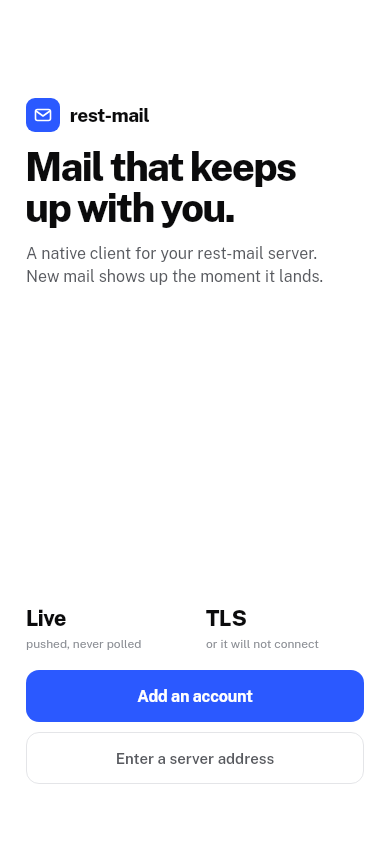</td>
<td valign="top">

### Welcome

The first launch has two ways in. **Add an account** starts from an email
address. **Enter a server address** is for a server that can't be found from
the domain. On the **Server** screen you type the address and tap **Test**,
which checks that rest-mail answers over HTTPS. **Use this server** only works
once the test passes. A plain `http://` address is refused.

</td>
</tr>
<tr>
<td valign="top" width="260">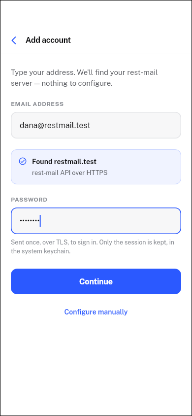</td>
<td valign="top">

### Adding an account

About half a second after you stop typing the domain, the app looks for a
rest-mail server at the domain and at `mail.<domain>`, and the card under the
address shows the result. If nothing is found, **Configure manually** opens the
Server screen. The password is sent once, to sign in. After that the app keeps
only the session, in the system keychain, one entry per account. A session
that ends without you signing out, because the server ended it, leaves the
account in the app, signed out: its mail screen says so, and **Sign in
again** has its address and server filled in.

If the account has two-factor authentication, a **Two-factor code** field
appears. **Use a recovery code instead** switches it to take a recovery code.

### Gmail and other mail (IMAP)

An address at Gmail, iCloud, Yahoo, Fastmail or Outlook.com is recognised as
you type it, and **Continue** opens its setup; **Other mail (IMAP)** opens the
same setup for any other address. The servers come from, in order: the app's
own presets for those providers, Thunderbird's autoconfig database, the
domain's own autoconfig file, then DNS SRV records, all fetched over HTTPS.

**Find working servers** searches the bare domain, common subdomains such as
`mail`, `imap`, `smtp`, `pop3` and `submission`, and published MX/SRV targets.
It tries the usual mail ports and any ports published by the provider, checks
the protocol capabilities and TLS certificate, and offers working IMAP and
SMTP endpoints as separate choices. The search sends no password, can be
cancelled, and stops after 45 seconds. POP3 is detected for diagnosis only:
adding an account requires IMAP. You can edit the discovered settings, and
**Check connection** checks your credentials on both selected servers before
you add the account.

- **Gmail** needs an app password. The setup explains the two steps (turn on
  2-Step Verification, then make an app password) with a link to each, and
  says so plainly if Gmail answers that it wants one.
- **iCloud, Yahoo and Fastmail** link to their own instructions for making an
  app password.
- **Outlook.com** signs in with Microsoft, since Microsoft turned off
  passwords for other mail apps in September 2024. So do work and school
  accounts whose servers are Microsoft 365's. **Sign in with Microsoft**
  opens Microsoft's own page in the system browser, which asks for the
  password and whether REST Mail may read and send the mail; the app never
  sees the password. A build without a Microsoft client ID (see
  [Development](#sign-in-with-microsoft-and-google)) shows no button and
  says Outlook.com needs Microsoft sign-in.
- **Sign in with Google** sits under Gmail's app-password setup, marked
  *personal use*. REST Mail's Google client is unverified, so Google warns
  about it and lets at most 100 people use the button (#37). Anyone can still
  add Gmail with an app password. A build without a Google client ID shows
  only the app password.

**Gmail behaves like Gmail.** The app knows it by its IMAP extensions
(`X-GM-EXT-1`), not its domain, so Google Workspace addresses count too:

- **Labels** are listed as folders, show under a message's subject, and
  **Labels…** in its menu puts them on and takes them off. Important is one
  of them.
- **Archive** takes a message out of the inbox; it stays in All Mail with its
  other labels. **Delete** puts it in Trash.
- **Conversations:** the list shows one row per conversation, grouped as
  Gmail groups them, with a count. An open message lists the rest of its
  conversation, your replies included. Archive, delete and spam act on the
  whole row.
- **Search** takes Gmail's own syntax (`from:`, `has:attachment`, `label:`,
  `older_than:`, `category:promotions`) and searches all mail.
- **Star** is Gmail's star, and sent mail appears in Sent once, as Gmail files
  it.

IMAP uses TLS on 993 or required STARTTLS on 143. SMTP uses TLS on 465 or
required STARTTLS on 587 or 2525; published custom ports are also supported.
A server that doesn't offer the required TLS upgrade is refused before the
password is sent. Credentials and messages only travel over TLS, and
certificate checks can't be turned off. The password
is kept in the system keychain with the account, since IMAP and SMTP want it
each time they connect. **Sign out** ends an account's session and keeps its
settings and place in the list, marked signed out. **Remove from this phone**
takes the account and its settings off the device. An account signed in with
Microsoft or Google keeps
no password, only the refresh token they gave it, in the keychain. The
access token it signs IMAP and SMTP in with (XOAUTH2) is kept in memory and
renewed before it runs out. If you take REST Mail's access away at Microsoft
or Google, or change your password there, that account signs out but stays in
the app, with its name, servers and place in the list. Its mail screen says
why, with **Sign in with Microsoft** (or Google) to carry on, and **Remove
from this phone** to take it off. The other accounts carry on. Signing out
of a Google account gives its token back to Google. While the app is open, IDLE
brings new mail in as it arrives.

</td>
</tr>
<tr>
<td valign="top" width="260">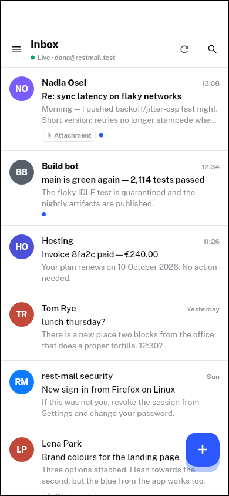</td>
<td valign="top">

### Inbox

The line under the folder name shows the connection: **Live** while the
server's event stream is up, **Connecting…** or **Offline · retrying**
otherwise. New mail arrives without a refresh.

- A blue dot marks unread mail, and an **Attachment** tag marks mail with
  files.
- Pull down or tap refresh to reload. Older mail loads as you scroll.
- Swipe left to move a message to Trash, with **Undo**. In Trash, swiping
  asks first, because the message is then deleted for good.
- Tap **+** to write a new message. Tapping a draft opens it for editing.

</td>
</tr>
<tr>
<td valign="top" width="260">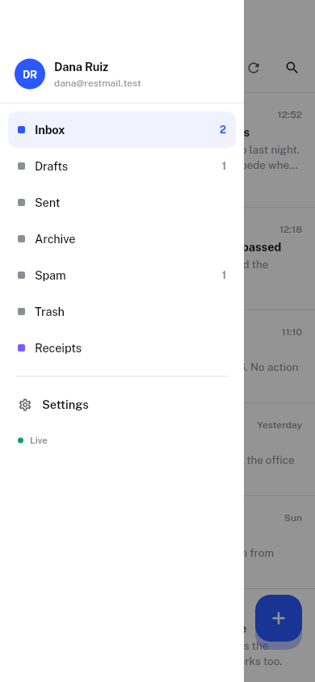</td>
<td valign="top">

### Folders and accounts

The menu button opens the drawer. Each folder shows its unread count, and
Drafts shows how many drafts there are. Folders the server has beyond the
standard ones, like **Receipts** here, are listed too. The account's other
mailboxes, the ones it created or linked, then any other accounts signed in
on the phone, sit as avatars next to the account
at the top; tap one to switch to it. **Settings** is at the bottom.

</td>
</tr>
<tr>
<td valign="top" width="260">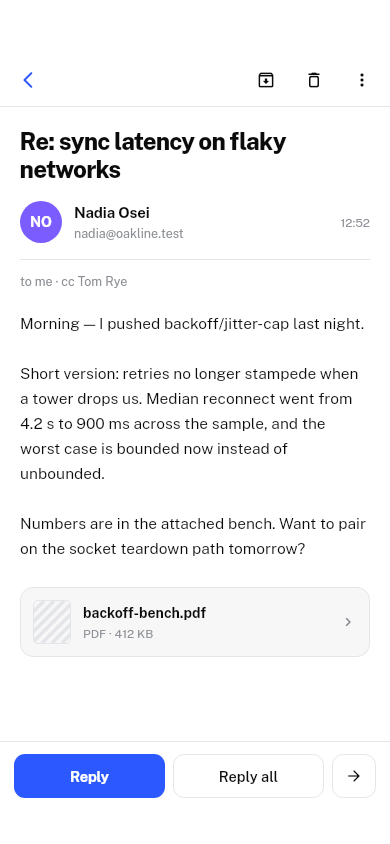</td>
<td valign="top">

### Reading a message

Opening a message marks it read. Tap the recipient line to see full addresses
and the date.

- The top bar has **Archive** and **Delete**. The **⋮** menu has **Mark as
  unread**, **Flag** and **Move to Spam** (**Not spam** when the message is in
  Spam). Moves can be undone.
- Tap an attachment to download it and open the share sheet. When there are
  several, a card opens a grid of them.
- **Reply** is always there. **Reply all** appears when other people are on
  the message, and the arrow is **Forward**.

</td>
</tr>
<tr>
<td valign="top" width="260">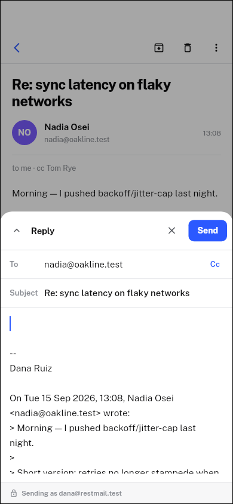</td>
<td valign="top">

### Replying

Compose opens as a sheet over the message. Reply adds `Re:` and quotes the
original. Forward adds `Fwd:` and the forwarded message. **Cc** reveals the Cc
and Bcc fields, and **From** appears when you have more than one mailbox. The
chevron makes the sheet full height. If you close it with changes, the app
asks whether to keep a draft; tapping outside the sheet doesn't close it.

New messages always get your signature. Replies and forwards get it only if
**Append on replies** is on, as it is here.

</td>
</tr>
<tr>
<td valign="top" width="260">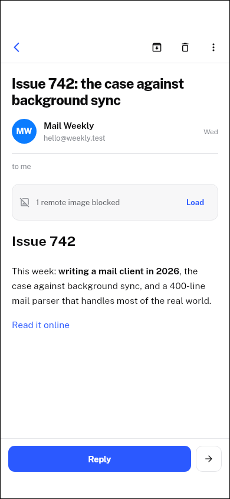</td>
<td valign="top">

### HTML mail

HTML mail is drawn as native widgets, not in a web view. Scripts, styles and
forms are removed. Remote images are blocked, and a bar counts them until you
tap **Load**. Links open only if they are `http`, `https` or `mailto`; a
`mailto` link opens compose.

</td>
</tr>
<tr>
<td valign="top" width="260">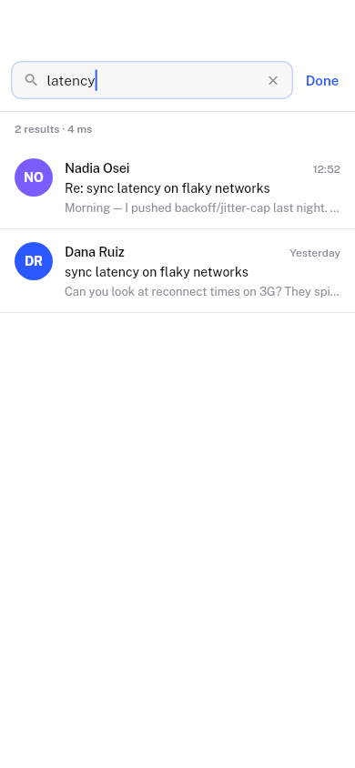</td>
<td valign="top">

### Search

Results update as you type and show how long the server took. Before you type,
the screen suggests `has:attachment`, `in:sent` and `from:`, then lists recent
searches. Recent searches are kept only until the app closes.

| Term | Matches |
|---|---|
| `from:<text>` | the sender |
| `in:<folder>` | one folder; standard folder names ignore case |
| `has:attachment` | mail with files |
| anything else | free text |

</td>
</tr>
<tr>
<td valign="top" width="260">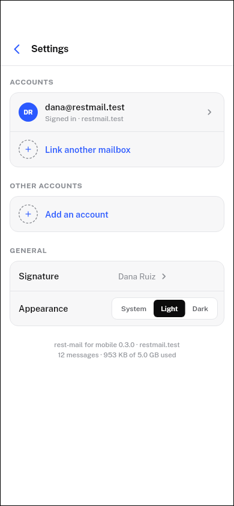</td>
<td valign="top">

### Settings

- **Accounts** lists the account on screen and the mailboxes it owns, the
  ones it created or linked. Tap one to see its display name, server and
  storage, and to **Sign out**, or **Unlink from this account** for one it
  owns. Signing out ends that account only: its session is removed from the
  phone, its mail stays on the server, and any other accounts stay signed
  in.
- **App passwords**, under each mailbox of a REST Mail account, are for mail
  apps such as Thunderbird or the iPhone's Mail, and for automations: each
  signs in to that mailbox with its own password, and can be revoked on its
  own. A mailbox with no password of its own gets mail-app access this way.
  An account with two-factor authentication must use one over IMAP and SMTP:
  its own password is refused there. The list shows when each was made, last
  used, and when it expires. Making one asks for the signed-in account's
  password again, as the server requires; a wrong one just asks again. The
  new app password is shown once, with the settings a mail app needs, and is
  forgotten when the screen closes. Copying it on iOS keeps it on that
  iPhone and clears it from the clipboard after two minutes; Android can't
  do either, so the app says other apps can read it. Revoking one stops it
  at once, open IMAP sessions included.
- **Create a mailbox**, for an account that may (`mailboxes:write`), makes a
  mailbox it owns, with no password of its own, on its own domain or any
  other the server hosts and the account may see. It shows at once in the
  drawer and here, and the account reads it and sends as it.
- **Link another mailbox** adds another mailbox on the same server to this
  account, by its password, and its code when it has two-factor
  authentication. An IMAP account is one mailbox, so it has no such rows.
- **Other accounts** lists the other accounts signed in on the phone; tap one
  to switch to it. **Add an account** signs in to another, on this server or
  any other, or adds Gmail or other mail over IMAP.
- **Signature** edits the signature, with a preview and the **Append on
  replies** switch.
- **Appearance** is **System**, **Light** or **Dark**.
- **Notifications** on iPhone always offers **Unread count on app icon**,
  even without a push token or a REST Mail server that sends notifications.
  Turning it on requests iOS notification permission. The badge sums the
  unread mail in every signed-in REST Mail and IMAP inbox, updating when
  the app checks mail and when messages are read or accounts removed. Its
  preference is stored on the phone, independently of new-mail alerts.
  If iOS has disabled badges, enable them in the iPhone's notification
  settings; returning to the app refreshes that permission.
- **New mail** is also offered when a signed-in REST Mail server can push.
  After sign-in the app explains alerts and asks before iOS does. The phone
  registers with each REST Mail session's server and unregisters at sign-out.
  Turning these alerts off keeps the unread badge enabled. A push names the
  account with mail; the app fetches the mail over the API and notifies of
  each new message, leaving out the inbox on screen. Gmail and other IMAP
  accounts do not receive these server signals. Their credentials remain on
  the phone, and a badge cannot keep checking them while iOS suspends the app.

Settings are stored only on the device.

</td>
</tr>
<tr>
<td valign="top" width="260">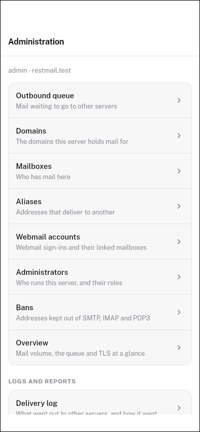</td>
<td valign="top">

### Administration

An administrator is an account like any other, `admin@example.com` say,
and signs in through **Add an account**. When its session holds
capabilities, **Administration** shows in the drawer and in Settings. A
fresh install's first account, `admin@` its domain, is set up from the app
with **Set up a new server**, or by scanning the installer's QR code: a new
password and an authenticator, and then the app opens its mail.

Administration lists only the parts the session's capabilities let it see:
the **Outbound queue** with `queue:read`, **Domains** with `domains:read`,
and so on. Inside each, the add, change and delete controls show only with
the capability for them, such as `queue:manage` to retry or bounce a
message. The server sends the capabilities with every sign-in and token
refresh, so one taken away on the server goes from the app at the next
refresh. Hiding is only for comfort: the server checks every request, and
when it refuses one the app says "You don't have permission for this".

The **Audit log** (`audit:read`) lists every sign-in and change, newest
first, and **Activity** shows what of it went through. **Verify chain** has the server check that each entry follows the
one before and matches its hash, and says where the chain breaks if it
does. A message in the **Delivery log** opens its **Message trace**: each
filter it went through and what that filter found. The **Pipeline log**
(`pipelines:read`) has the trace of every message the filters handled,
mail they turned away too, and **Pipeline analytics**
(`observability:read`) counts what they did over a day or a week.

A domain opens its **DNS check**, which says which of its records are right
and which are missing, its **Sender lists** of senders turned away and
senders let past the spam checks, and its **MTA-STS** policy. All three are
read with `domains:read` and changed with `domains:write`.

A phone can remove a DKIM key or a certificate, and turn a pipeline or a
custom filter on or off, but setting a key, adding a certificate and
editing filters are left to the admin webmail.

</td>
</tr>
</table>

### Dark

Every screen also has a dark version:

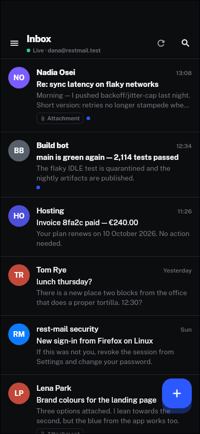 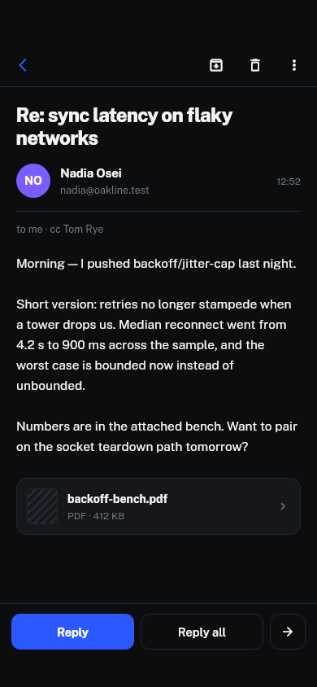 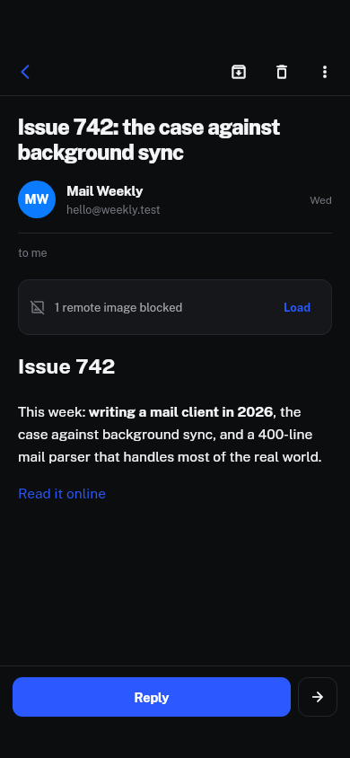

## Layout

| Path | What |
|---|---|
| `lib/` | The app |
| `packages/restmail_api/` | The REST client as a plain Dart package: sign-in and token refresh, mail, the event stream, server discovery. It has no Flutter code, so its tests run with `dart test`. |
| `packages/restmail_fake/` | An in-memory rest-mail that speaks the same API, for tests and for running the app with no server |
| `tool/screens/` | Draws every screen against the fake, for looking at |
| `assets/fonts/` | Public Sans (SIL Open Font License) |

## Development

You need Flutter 3.47.1 (stable), Xcode 26 for iOS, and the Android SDK
(platform 36) with JDK 17 or 21 for Android. CocoaPods is not needed: every
plugin resolves through Swift Package Manager.

```sh
chore get      # dependencies for the app and both packages
chore check    # format, analyze and test everything, as CI does
flutter run
```

### Sample mail, no server

`chore run:sample` runs the app against the in-memory rest-mail in
`packages/restmail_fake`. Every screen works, on a simulator or a phone,
with no server anywhere. Sign in as `dana@restmail.test` with the password
`restmail`; the sign-in screen shows these as well. `SCENARIO=empty`
starts with no mail. `SCENARIO=twoFactor` asks for the code `123456`. To
try Administration, sign in as `admin@restmail.test`, who may do
everything, or `queue@restmail.test`, who may only look at the queue; the
password is `restmail-admin` and the code `123456`. Only debug builds can do this.

`chore sim:sample` builds the same thing and starts it in the iOS simulator,
booting one first if none is running, with no terminal left attached. The
sign-in screen comes up filled in, so it is one tap to the mailbox.

`chore screens` walks the app through its screens in light and dark
against the same fake, and saves a picture of each in `build/screens/`.
The pictures in `media/` are copies of these, used in the walkthrough above.
Copy them over again when a screen changes.

### Sign in with Microsoft and Google

The OAuth client IDs come from the build, never from the source. Without
them the app builds and runs as before, with no sign-in buttons:

```sh
flutter run \
  --dart-define=MS_CLIENT_ID=<Entra application (client) ID> \
  --dart-define=GOOGLE_IOS_CLIENT_ID=<id>.apps.googleusercontent.com \
  --dart-define=GOOGLE_ANDROID_CLIENT_ID=<id>.apps.googleusercontent.com
```

They are public clients, so an ID is not a secret and there is no client
secret anywhere: the app proves each sign-in with PKCE. TestFlight builds
take `MS_CLIENT_ID` and `GOOGLE_IOS_CLIENT_ID` from variables in the
`release` environment (`gh variable set MS_CLIENT_ID --env release`); while
they are unset, the build has no sign-in buttons. The redirects the
registrations must list are:

| Provider | Redirect URI |
|---|---|
| Microsoft (iOS and Android) | `rest-mail://oauth/microsoft` |
| Google, iOS client | `com.googleusercontent.apps.<id>:/oauth2redirect`, the iOS client ID reversed |
| Google, Android client | `com.antimatterstudios.restmail:/oauth2redirect`, with *custom URI scheme* turned on in the client's advanced settings |

`lib/imap/oauth.dart` holds the flow: the PKCE pair, the state check, the
code exchange and the refresh, over the app's own HTTPS client.
`flutter_web_auth_2` only shows the provider's page, in
ASWebAuthenticationSession on iOS and a Custom Tab on Android, and hands
back the URL it returns to. `test/imap/fake_auth_server.dart` plays the
provider in the tests.

### Against a local testbed

The testbed signs its certificates with its own CA. You can tell a debug build
to trust that CA:

```sh
mkdir -p .dev
python3 -c 'import json,sys; print(json.dumps({"RESTMAIL_DEV_CA": open(sys.argv[1]).read()}))' \
  path/to/testbed-ca.crt > .dev/testbed.json
flutter run --dart-define-from-file=.dev/testbed.json
```

Profile and release builds ignore this define. The simulator or emulator also
has to resolve the testbed's host names.

### Against a stack behind ddt

When rest-mail runs locally behind [ddt](https://github.com/antimatter-studios/docker-dev-tools),
its proxy serves `https://restmail.localhost` with a certificate from ddt's own
CA. `chore sim:local` does the above with that CA (`ddt ca path`) and starts the
debug build in the iOS simulator; add the account with the server
`https://restmail.localhost`. Nothing is added to the Mac's or the simulator's
trust store: only this debug build trusts the CA, and it still checks every
certificate against it.

### A TestFlight build

A release is a tag, and every merge into `main` makes one:
`.github/workflows/release-on-merge.yml` tags each commit that lands on `main`
as `vMAJOR.MINOR.<build count>`: `pubspec.yaml`'s MAJOR.MINOR, with the number
of commits behind it as the patch, so 0.2 at 28 commits is v0.2.28. It pushes
the tag with the token `auto-merge.yml` uses, because a tag pushed with the
workflow's own token would start no build. Releases happen only this way: if
a commit did not get its tag, re-run that workflow's job.

`.github/workflows/testflight.yml` builds the tag as 0.2.28 (28), signs it, hands
it to App Store Connect — internal testers have it as soon as processing
finishes — and publishes it on the Releases page. The build count only goes
up, so no version comes round twice; raise MINOR in `pubspec.yaml` for a
release with something new in it. `tool/ci/release_gate.sh` refuses a tag
that is not `vMAJOR.MINOR.PATCH`, whose patch is not its commit's build count,
that names a commit not on `main`, or that is older than the newest release.

That workflow stands in for a Mac signed in to the developer account, so it
needs the signing material. It lives in the `release` environment, which only
`v*` tags can use: no branch, `main` included, can read it. The comment at the
top of the file lists all six secrets and says where each comes from. Set them
with `gh secret set <NAME> --env release`, which keeps the values out of shell
history.

The same build on a Mac that *is* signed in:

```sh
chore ipa
```

Either way the build number is the count of commits on `HEAD`, so every build
from a newer `main` can be uploaded and each one names the commit it came
from. `chore ipa` refuses to build with uncommitted changes, for the same
reason: the number would name a commit the build does not match. `chore ipa`
names the build the same way a release does, MAJOR.MINOR.<build count>.

## Identity

The app ID is `com.antimatterstudios.restmail` on both platforms. It ships
under Apple Developer team `43UMKXZ8P4`.

## Not yet

- Notifications on Android, which needs FCM, and for IMAP accounts, which
  need something server-side. On iPhone they need a server that pushes
  through APNs (rest-mail-mobile#8).
- Creating a Gmail label from the app.
- Sending attachments. The send API has no field for them.
- Contacts, vacation replies, Sieve filters and quarantine.
- Editing a pipeline's filters or a custom filter, and making new ones.
